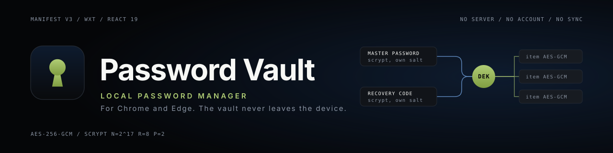
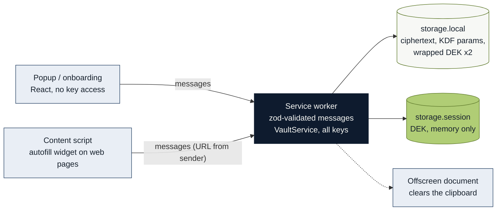
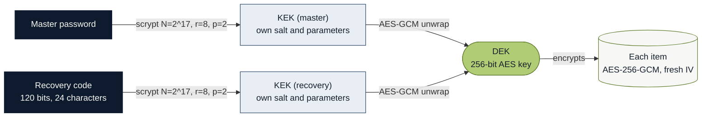

<p align="center">
  
</p>

<p align="center">
  
  
  
  
  <a href="#tests"></a>
  
</p>

<p align="center">
  A local password manager for Chrome and Edge.<br>
  The vault is encrypted on the device and never leaves it: no server, no account, no sync.
</p>

<p align="center">
  <a href="#security-model">Security model</a> &nbsp; / &nbsp;
  <a href="#architecture">Architecture</a> &nbsp; / &nbsp;
  <a href="#local-development">Development</a> &nbsp; / &nbsp;
  <a href="design-system/pimsa-password-vault/MASTER.md">Design system</a>
</p>

<br>

## The idea

Most password managers ask you to trust a service: an account, a sync server, a
company that holds an encrypted copy of your vault. Password Vault removes that
party. Everything is stored in the browser's own extension storage, encrypted, and
the extension makes no network requests at all, so there is nothing to breach and
nothing to be locked out of by a provider.

The cost of that choice is stated plainly in [what this design cannot
do](#what-this-design-cannot-do). The rest of the project follows from it: a small
permission list, a key hierarchy built so that changing a password never re-encrypts
the vault, and an autofill path written on the assumption that the page is hostile.

It is a Manifest V3 extension built with [WXT](https://wxt.dev), React 19 and
TypeScript.

> [!NOTE]
> The interface is in Spanish; code and documentation are in English.

<br>

## Status

It works end to end: creating the vault, saving logins, secure notes and cards,
searching, autofilling login forms, copying with automatic clipboard clearing,
changing the master password, locking on inactivity, a recovery code, and encrypted
export and import.

What it does **not** do yet:

- **There is no settings screen.** The auto-lock delay (15 minutes) and the clipboard
  clearing delay (30 seconds) are fixed in [`src/core/policy.ts`](src/core/policy.ts).
- **There are no interface tests.** The 216 tests cover the core, cryptography, domain
  matching, the platform adapters and DOM manipulation; no React component is covered.
- **It does not detect sign-up forms** to offer saving a new credential. Credentials
  are created by hand from the popup.

<br>

## What is inside

<table>
  <tr>
    <td width="33%" valign="top">
      <strong>Local by construction</strong><br>
      The vault lives in <code>storage.local</code> as ciphertext. There is no server, no account and no sync, and fonts are bundled rather than fetched, so opening the popup never makes a request.
    </td>
    <td width="33%" valign="top">
      <strong>Logins, notes and cards</strong><br>
      Typed items with search, favourites, a password generator and a strength meter. The popup is a 380 by 600 panel designed for finding one credential quickly.
    </td>
    <td width="33%" valign="top">
      <strong>Autofill on demand</strong><br>
      A button beside the login field, in a closed shadow DOM. Nothing is filled until you click it, and the page never learns a password before you choose an entry. <a href="#autofill">Threat model</a>.
    </td>
  </tr>
  <tr>
    <td width="33%" valign="top">
      <strong>Envelope encryption</strong><br>
      One random key encrypts every item; two independent envelopes open that key, one from the master password and one from the recovery code. <a href="#security-model">Details</a>.
    </td>
    <td width="33%" valign="top">
      <strong>Locks itself</strong><br>
      The vault closes after 15 minutes without activity and when the operating system session is locked. Copied passwords are cleared from the clipboard after 30 seconds.
    </td>
    <td width="33%" valign="top">
      <strong>Backup that you hold</strong><br>
      A recovery code returns access; a password-protected export file returns the data. The import merges by item id and keeps the newest edit, so repeating it is harmless.
    </td>
  </tr>
</table>

<br>

## Architecture

The popup, the onboarding page and the content script never touch a key. They send
typed messages to the service worker, which validates every one with zod, holds the
keys and is the only code that reads or writes the vault.



The code is split along two boundaries that ESLint enforces. `src/core/**` may not
import anything from the browser, the DOM, React or the UI, so the whole core,
cryptography included, is tested in Node with no extension in the way. The UI may not
import `src/core/crypto/*` or `src/platform/*`, so a key cannot cross into an
interface file by accident.

```text
src/core/        Pure core: crypto, model, use cases. No browser APIs
  crypto/          scrypt, AES-GCM, key hierarchy, recovery code
  vault/           service, repository, backup, search, master-password policy
  model/           zod schemas; the types are inferred from them, not declared apart
src/platform/    Adapters: storage, session, alarms, clipboard, form filling
src/messaging/   Typed protocol between the worker and the interface
src/ui/          Components, hooks and the design-system tokens
entrypoints/     background (service worker), popup, content, onboarding, offscreen
design-system/   Design rules and the extension icon
Mk/              Brand palette the UI tokens are translated from
tests/           Vitest suites (unit/ and platform/)
```

<br>

## Stack

| Layer          | Technology                                     | Role                                                           |
| -------------- | ---------------------------------------------- | -------------------------------------------------------------- |
| Extension      | Manifest V3, WXT                               | Build, dev server with hot reload, store packaging             |
| Interface      | React 19, Tailwind CSS 4, lucide-react         | Popup and onboarding; styling through semantic theme tokens    |
| Language       | TypeScript, strict                             | Types inferred from zod schemas                                |
| Key derivation | scrypt, `@noble/hashes`                        | Pure JS, so the CSP needs no `wasm-unsafe-eval`                |
| Encryption     | AES-256-GCM, WebCrypto                         | Authenticated encryption of items and key envelopes            |
| Validation     | zod 4                                          | Every message, item and backup file is parsed on arrival       |
| Typography     | Inter, JetBrains Mono (`@fontsource-variable`) | Bundled locally; the monospace face is used for secrets        |
| Checks         | Vitest, ESLint, Prettier, Husky, lint-staged   | Tests, enforced import boundaries, formatting, pre-commit gate |

<br>

## Local development

You need Node.js with npm, and Chrome or Edge. Install from the lockfile; the
`postinstall` step runs `wxt prepare`, which the tests need to resolve the TypeScript
configuration.

```bash
npm ci
npm run dev          # Edge with hot reload
npm run dev:chrome   # Chrome
```

`npm run dev` needs the paths to the browser binaries in `web-ext.config.ts`, which is
git-ignored because it is specific to each machine.

To load a build by hand, open `chrome://extensions`, turn on developer mode, choose
"Load unpacked" and select `.output/chrome-mv3` after `npm run build:chrome`.

| Command                              | Purpose                                           |
| ------------------------------------ | ------------------------------------------------- |
| `npm run dev` / `npm run dev:chrome` | Development build with hot reload (Edge / Chrome) |
| `npm run build` / `build:chrome`     | Production build (Edge / Chrome)                  |
| `npm run zip` / `zip:chrome`         | Store package                                     |
| `npm test`                           | Run the Vitest suite once                         |
| `npm run test:watch`                 | Run the suite in watch mode                       |
| `npm run check`                      | `tsc --noEmit`, ESLint and Vitest in sequence     |
| `npm run lint` / `npm run format`    | ESLint, and Prettier in write mode                |
| `npm run icons`                      | Regenerate the extension icons and `icon.svg`     |

The Husky pre-commit hook runs lint-staged (ESLint and Prettier on staged files), then
`npm run compile` and `npm test`.

<br>

## Security model

The key hierarchy is envelope encryption with **two recipients over one key**. A random
data-encryption key (DEK) encrypts every item. The DEK is stored twice, each copy
wrapped by a key-encryption key (KEK) that is derived from a different secret.



Either envelope opens the DEK, and they are independent. Changing the master password
does not invalidate the recovery code, and items are never re-encrypted: only the
master envelope is rewritten.

- **Key derivation.** scrypt from `@noble/hashes`, covered by Cure53's audit, with
  N=2^17, r=8, p=2. That is twice the OWASP minimum cost with the same memory
  footprint (128 MiB), raised through `p` rather than `N` because asking a Manifest V3
  service worker for 256 MiB risks the browser killing it during unlock. It is pure JS
  on purpose, which keeps the CSP in its strictest form (`script-src 'self'`, no
  `wasm-unsafe-eval`). The parameters are stored in the vault header, so hardening them
  later does not invalidate existing vaults.
- **Encryption.** AES-256-GCM from WebCrypto, with a fresh IV for every operation.
  Because it is authenticated encryption, altering a single byte makes decryption fail
  instead of returning tampered data.
- **Keys live only in the service worker.** Neither the popup nor any page sees them.
  They request operations by message and receive only the data of the item they asked
  for.
- **The DEK lives only in `storage.session`**, which is memory and never touches the
  disk. It survives Manifest V3 killing the service worker, and locking really erases it.
  The extension never calls `setAccessLevel()` on that area, so content scripts, which
  run inside web pages, cannot read it.
- **Messages are validated with zod on arrival** at the worker, even when they come
  from the extension itself.

### Autofill

This is the only part that runs code inside sites we do not control, so it is built on
the assumption that the page is hostile.

- **The page does not decide which domain it is.** Autofill messages carry no URL; the
  service worker derives it from the `sender` that the browser fills in. Without this,
  a page could simply ask for "the credential for my-bank.com".
- **The match is checked again when the secret is delivered**, not only when listing.
  Knowing a credential's id is useless from another domain.
- **Domains are compared by labels, never by substrings.** `evil-github.com` and
  `github.com.attacker.net` are not GitHub. This is pinned in
  [`tests/unit/urlMatch.test.ts`](tests/unit/urlMatch.test.ts).
- **The list drawn on the page contains no passwords**, only title and username. The
  secret travels only after the user picks a specific entry.
- **Nothing fills itself.** It takes a click on our own button, and invisible fields
  are discarded: a hidden login form is the known way to make a manager hand over
  credentials without the user seeing anything.
- **The widget lives in a closed shadow DOM**, so the site's CSS cannot hide or distort
  it, and the injected bundle includes no cryptography.

### What this design cannot do

> [!WARNING]
> If you forget the master password **and** lose the recovery code, the contents are
> gone. There is no back door; it is the direct consequence of having no server.

The recovery code returns _access_; the export file returns the _data_. After a dead
disk you need both. That file **is** the vault: saving it in a synced folder uploads a
complete copy to the cloud, which is exactly what this project avoids.

### Permissions

The extension asks for four: `storage`, `alarms`, `idle` and `offscreen`. It does not
ask for `host_permissions`, `scripting`, `activeTab` or `tabs`. The content script is
declared with its `matches`, which in Manifest V3 is already the authorization to
inject it, and the origin of each message arrives in `sender.url` without needing
`tabs`. `offscreen` exists to host a document that clears the clipboard, the only way
to touch it from a service worker; it does not imply `clipboardRead`, because the
extension writes over the clipboard and never reads what the user copies. The full
reasoning is commented in [`wxt.config.ts`](wxt.config.ts).

<br>

## Tests

```bash
npm test
```

216 Vitest cases in 17 files cover the core, the cryptography, domain matching, the
platform adapters and the form-filling DOM code. The core never imports a browser API,
so it runs in Node, and its test doubles are small in-memory fakes
([`tests/unit/fakes.ts`](tests/unit/fakes.ts)) rather than a browser mock.

<br>

## Documentation

| Document                                                                                                 | For                                                        |
| -------------------------------------------------------------------------------------------------------- | ---------------------------------------------------------- |
| [`design-system/pimsa-password-vault/MASTER.md`](design-system/pimsa-password-vault/MASTER.md)           | Colour, themes, type, motion and the reasoning behind them |
| [`design-system/pimsa-password-vault/pages/popup.md`](design-system/pimsa-password-vault/pages/popup.md) | The popup surface, which overrides the master rules        |
| [`Mk/PALETA-PIMSA.md`](Mk/PALETA-PIMSA.md)                                                               | The brand palette the UI tokens are translated from        |

<br>

<p align="center">
  <sub>No licence is defined for this project. All rights reserved.</sub>
</p>
